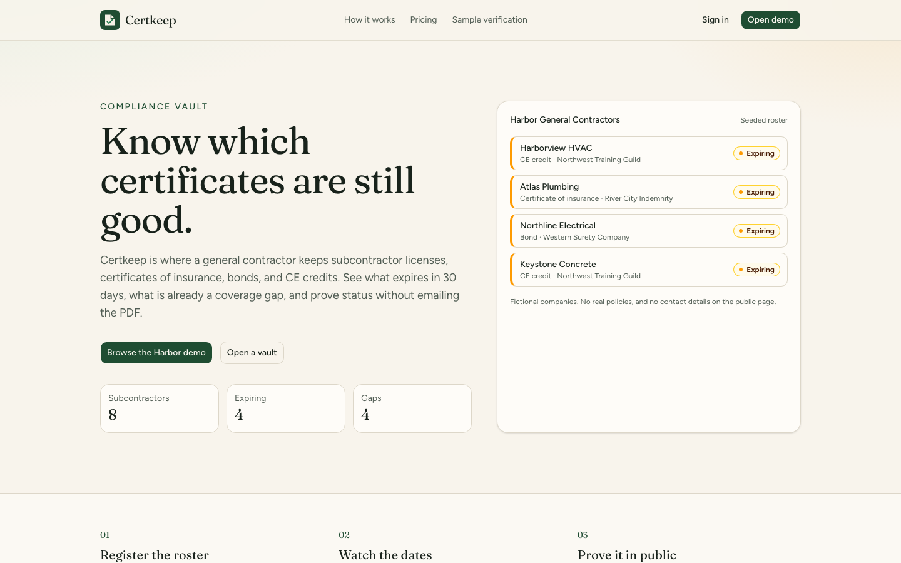
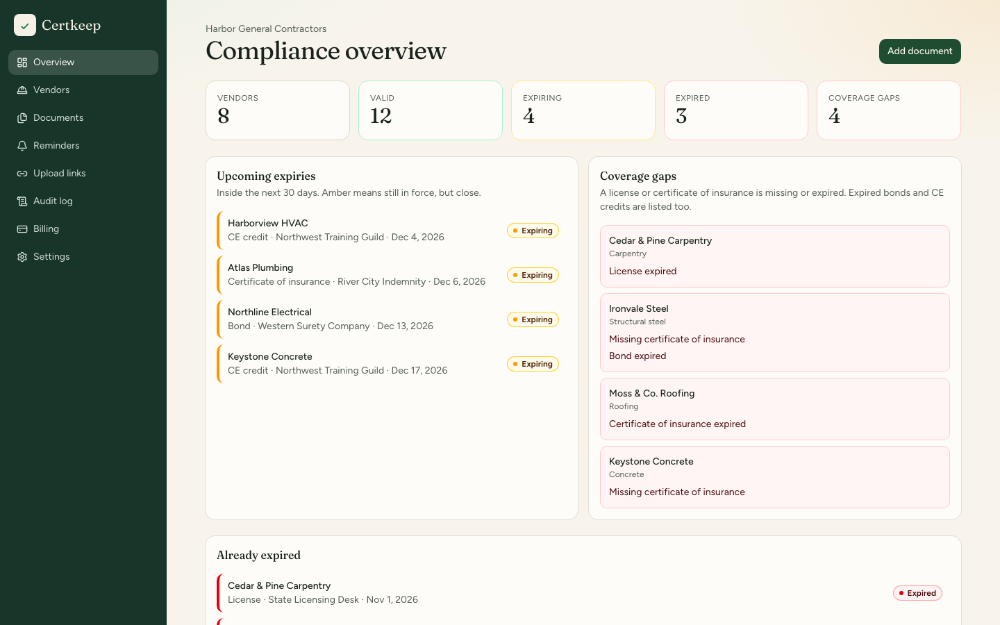
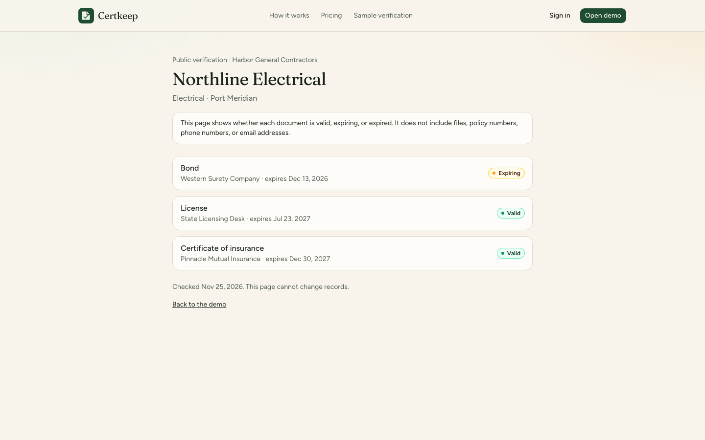
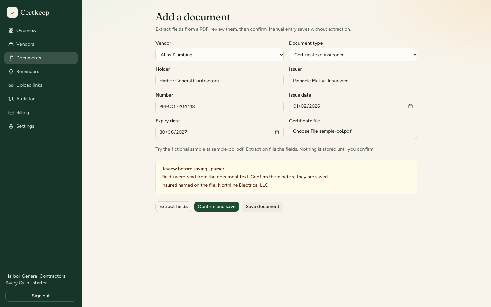

# Certkeep

Certkeep is a multi-tenant license and insurance compliance vault for general contractors and the agencies that watch their subcontractors. Each organization keeps its own vendors, certificate files, reminder schedule, and audit history. A public verification page shows whether a document is valid, expiring, or expired without handing out the file or a phone number.

The app runs with **zero environment variables**. Auth, data, email, Stripe, and certificate extraction all have deterministic mocks. Live keys are optional and documented below.

Target demo host: [certkeep.quvantic.com](https://certkeep.quvantic.com). Vercel project name: `certkeep`.

## Screenshots









## Run locally

```bash
npm install
npm run dev
```

Open [http://127.0.0.1:3000](http://127.0.0.1:3000).

```bash
npm run typecheck
npm run lint
npm run test:e2e
```

`test:e2e` builds the app and runs Playwright against `http://127.0.0.1:41731`. GitHub Actions does the same on `ubuntu-latest` with no secrets. Playwright is `@playwright/test` 1.65.1 or newer so `playwright install --with-deps` works on current Ubuntu images.

## Demo accounts

All of these are fictional. Passwords are demo credentials, not production secrets.

| Who | Email | Password | What you get |
| --- | --- | --- | --- |
| Harbor owner | `avery.quin@harbor.example` | `harbor-demo` | Harbor General Contractors, eight subcontractors |
| Lakeside owner | `jordan.hale@lakeside.example` | `lakeside-demo` | A second tenant. Cannot see Harbor. |
| Super admin | `rowan.admin@certkeep.example` | `super-demo` | Platform counts only. No vendor files. |
| Read-only demo | none | none | Open `/demo`. Writes return 403. |

The seeded roster mixes valid, expiring (within 30 days), and expired licenses, certificates of insurance, bonds, and CE credits. Coverage gaps are missing or expired required documents (license and certificate of insurance), plus any expired bond or CE credit.

Sign-in buttons on `/login` fill these accounts. A new organization from `/signup` starts empty on Starter.

## Sample certificate

`public/samples/sample-coi.pdf` is a fictional certificate of insurance generated by `npm run sample:pdf`. It is not a policy.

Labeled fields the extractor reads:

- Certificate holder: Harbor General Contractors
- Insured: Northline Electrical LLC
- Issuer: Pinnacle Mutual Insurance
- Policy number: PM-COI-204418
- Issue date: 2026-02-01
- Expiration date: 2027-06-30

On **Add a document**, choose that file and **Extract fields**. Review the holder, issuer, and expiry, then **Confirm and save**. Nothing is stored until you confirm. With no `GROQ_API_KEY` or `GEMINI_API_KEY`, the reader is deterministic. If a file has no labels and no model key, the form fills obvious placeholders and says so.

## What works without keys

- Email and password sessions (signed cookie; demo signing key when `SESSION_SECRET` is unset)
- Organizations, vendors, documents, file upload (kept in process memory)
- Status colors: green valid, amber expiring within 30 days, red expired
- Dashboard of upcoming expiries and coverage gaps
- Reminder schedule at 30, 14, and 7 days, with a mocked outbox
- Vendor self-upload link at `/request/[token]`
- Public verification at `/verify/[publicId]`
- Append-only audit log (PATCH and DELETE return 405)
- Starter and Pro plan changes in mock checkout
- Super-admin console
- Public read-only Harbor demo

On Vercel, mock writes live in the instance that handled the request. A cold start returns to the seed. That is expected without a database. Local `next dev` and `next start` keep the vault for the life of the process. Playwright resets it through `POST /api/test/reset`, which answers only when `E2E=1` and the app is not on Vercel.

## Optional live environment variables

Copy `.env.example`. Leave blanks to stay in mock mode.

| Variable | Used for |
| --- | --- |
| `SESSION_SECRET` | Signs the session cookie. Set a long random value before any real deployment. |
| `NEXT_PUBLIC_SUPABASE_URL` | Supabase project URL |
| `NEXT_PUBLIC_SUPABASE_ANON_KEY` | Publishable client key. Never put the secret key in `NEXT_PUBLIC_`. |
| `SUPABASE_SERVICE_ROLE_KEY` | Server-only. Not required for the mock vault. |
| `STRIPE_SECRET_KEY` | Test-mode secret. Checkout redirects to Stripe when this and a price id are set. |
| `STRIPE_WEBHOOK_SECRET` | Verifies `checkout.session.completed` and updates the plan. |
| `NEXT_PUBLIC_STRIPE_PUBLISHABLE_KEY` | Reserved for a future client-side Stripe.js step. |
| `STRIPE_PRICE_STARTER` | Recurring price id for Starter ($49) |
| `STRIPE_PRICE_PRO` | Recurring price id for Pro ($149) |
| `GROQ_API_KEY` / `GROQ_MODEL` | Live extraction. Default model `llama-3.3-70b-versatile`. |
| `GEMINI_API_KEY` / `GEMINI_MODEL` | Used when Groq is unset. Default model `gemini-2.0-flash`. |

Apply `supabase/migrations/0001_certkeep.sql` before pointing a project at this schema. The migration enables RLS on every table, keeps `platform_role` on `profiles` (not user-editable metadata), blocks anonymous table reads, exposes only safe columns through `vendor_public_status`, and stores files in the private `compliance-files` bucket under `{org_id}/...`. Audit rows can be inserted and selected by members. Update and delete are revoked.

The running request path uses the in-memory vault even when Supabase variables are present, so a half-configured project cannot silently bypass tenant checks. Health is at `GET /api/health`.

Stripe test cards and webhook forwarding stay in the Stripe dashboard. No card is charged in mock mode.

## What Mustafa needs to provide

1. A Supabase project, then the URL, publishable key, and a server-only service role key if the SQL schema should be applied and later connected.
2. Stripe test-mode secret, webhook secret, and Starter/Pro price ids.
3. Either a Groq API key or a Gemini API key if extraction should call a model instead of the local reader.
4. A real `SESSION_SECRET` before the host is treated as production.
5. DNS for `certkeep.quvantic.com` once the Vercel project `certkeep` exists under the Mustafa account (`mustafaautomation`).

None of those are required to click through the seeded Harbor vault.

Certkeep records dates and files you upload. It does not give legal, insurance, or coverage advice.
